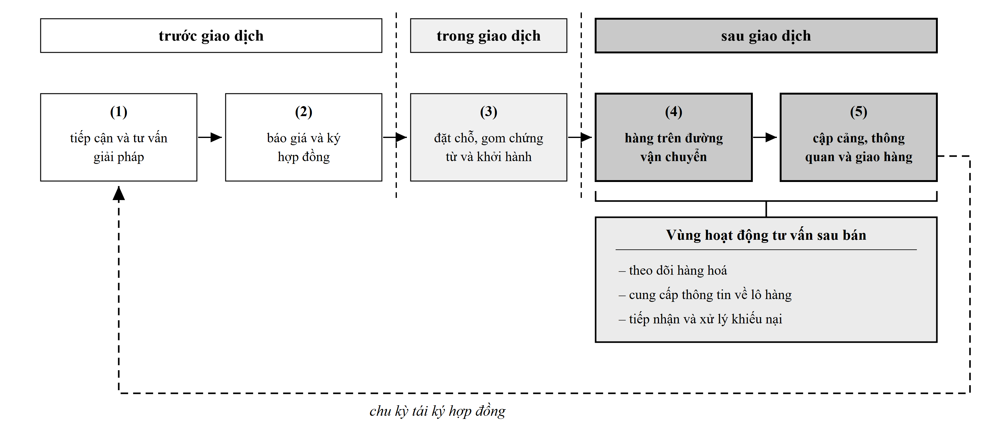
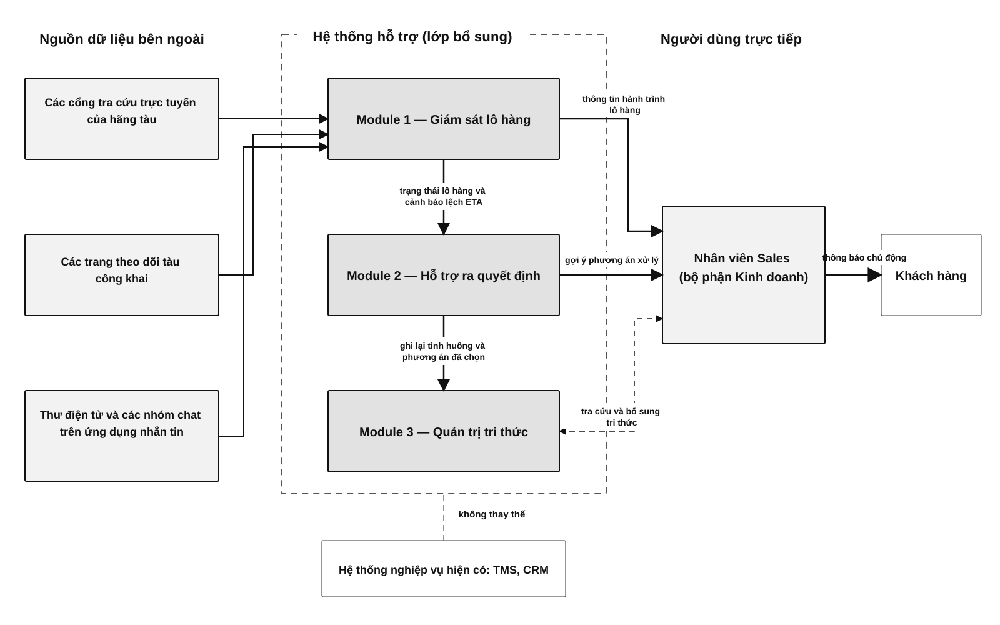

# Hệ Thống Giám Sát Lô Hàng Đường Biển Thời Gian Thực

Lớp ứng dụng theo dõi sau bán hàng dành cho công ty giao nhận vận tải container, chuyển đổi quy trình xử lý thắc mắc từ bị động sang phát hiện trễ chuyến chủ động.

> Bản tiếng Việt. [English version](README.md) · [Phân Tích Nghiệp Vụ](docs/business-analysis.md) · [Kiến Trúc](docs/ARCHITECTURE.md) · [Quy Trình Kỹ Thuật](docs/ENGINEERING-PROCESS.md) · [Quyết Định Kiến Trúc](docs/decisions/)

## Hình Ảnh Giao Diện

| Hành trình khách hàng | Kiến trúc hệ thống |
|---|---|
|  |  |

[](docs/GALLERY.md)

## Vấn Đề Nghiệp Vụ

- Nhân viên kinh doanh theo dõi đồng thời 20 đến 30 lô hàng FCL trên bốn đến năm nguồn rời rạc, tốn 15 đến 30 phút cho mỗi lần khách hàng hỏi thông tin.
- Khoảng 90% câu hỏi từ khách hàng gửi đến trước khi nhân viên kịp cập nhật chủ động, đặt doanh nghiệp vào thế chăm sóc sau bán bị động.
- Doanh nghiệp tiếp nhận thông báo đổi lịch từ hãng tàu trễ từ 2 đến 4 giờ sau khi phát hành, làm mất thời gian dự phòng để điều phối xe kéo và kho bãi.
- Tình trạng ùn tắc tại cảng đích và giới hạn mớn nước thủy triều (điển hình tại Cát Lái) thường xuyên làm chậm thời điểm cập bến nhưng không có cảnh báo tự động.
- Tri thức xử lý tình huống và kinh nghiệm tra cứu định danh tàu phân tán trong trí nhớ cá nhân thay vì được chuẩn hoá vào hệ thống.

## Giá Trị Đạt Được

- Tập trung thông tin theo dõi container vào một màn hình duy nhất, hiển thị vị trí tàu thời gian thực, tiến độ hành trình và điều kiện hải văn.
- Thay thế thao tác tra cứu thủ công trên cổng hãng tàu bằng quy trình lấy ETA baseline tự động trong giai đoạn onboarding lô hàng.
- Tính toán lại ETA cập cảng liên tục dựa trên dữ liệu định vị AIS, tốc độ gió, dòng chảy bề mặt và khung giờ thủy triều tại cảng đích.
- Tự động tiếp nhận email thông báo từ hãng tàu để nhận diện trường hợp rớt tàu (rollover) và thay đổi lịch trình.
- Tạo đề xuất cập nhật có cấu trúc để nhân viên phê duyệt, bảo vệ dữ liệu nghiệp vụ trước các nguồn thông tin chưa xác thực.
- Cảnh báo chủ động cho chủ hàng trước khi mức chênh lệch ETA vượt ngưỡng vận hành cho phép.

## Cơ Chế Vận Hành

Hệ thống vận hành như một lớp bổ trợ bên cạnh hệ thống quản lý vận tải (TMS) và quản trị quan hệ khách hàng (CRM) hiện hữu; không thay thế các hệ thống cốt lõi.

```text
Tiếp Nhận Lô Hàng (B/L, Container, Incoterm, Tàu / Chuyến)
   │
   ├──> Onboarding: Phân giải IMO (Playwright) + Tra cứu ETA Hãng (Playwright MCP)
   │
   ├──> Giám Sát Thời Gian Thực: AIS Worker (WebSocket aisstream.io) + Cập Nhật Thời Tiết / Thủy Triều
   │
   ├──> Động Cơ Tính ETA: Luật 2 Tầng (Động học hành trình + Hiệu chỉnh gió / dòng chảy / thủy triều)
   │
   ├──> Phân Tích Chuyên Gia: Agent A (AG2) tổng hợp nhận định định tính hỗ trợ quyết định
   │
   └──> Tiếp Nhận Email: IMAP Poller + Trích xuất LLM ──> Đề xuất chờ duyệt ──> Nhân viên phê duyệt
```

Con số ETA do động cơ quy tắc hai tầng tính toán, không sử dụng mô hình học máy. Tầng 1 tính khoảng cách và vận tốc động học dọc hành trình đã xác thực. Tầng 2 áp dụng các hệ số hiệu chỉnh thực nghiệm cho gió ngược, dòng chảy đối kháng và mớn nước thủy triều tại cảng đích. Mô hình ngôn ngữ lớn (LLM) đảm nhiệm vai trò điều phối công cụ và diễn giải nhận định định tính; không tự sinh số liệu ETA baseline.

## Cơ Chế Kiểm Soát Con Người (Human-in-the-Loop)

- Email từ hãng tàu được xem là đầu vào chưa xác thực; agent email không bao giờ tự động cập nhật dữ liệu lô hàng hay chặng vận chuyển.
- Thông tin trích xuất về đổi lịch hoặc rớt tàu được lưu thành bản ghi chờ duyệt trong bảng `agent_proposals`.
- Nhân viên trực tiếp kiểm tra và phê duyệt hoặc từ chối đề xuất qua giao diện trước khi dữ liệu có hiệu lực.
- Khi phê duyệt, hệ thống cập nhật chặng vận chuyển đang kích hoạt, gửi tín hiệu đăng ký lại AIS và ghi nhận lịch sử vào bảng nhật ký kiểm toán (`eta_history`).
- Tính năng tự động chuyển tiếp thông báo chỉ gửi tới danh sách người nhận nội bộ được cấu hình cố định trong biến môi trường máy chủ.

## Quy Mô Triển Khai Thực Tế

- Thiết kế và hiện thực 10 mô hình quan hệ trong cơ sở dữ liệu với migration Alembic chiều tiến (forward-only) và dữ liệu mẫu seed có tính bất biến.
- Xây dựng 39 bộ kiểm thử backend và kiểm thử thành phần giao diện, bảo đảm hoạt động độc lập và tất định khi không có mạng.
- Đóng gói hoàn chỉnh 5 dịch vụ container: backend FastAPI, scraper Playwright MCP, PostgreSQL 16, Redis 7 và reverse proxy Caddy tự động cấp chứng chỉ TLS.
- Kiểm chứng toàn bộ chuỗi giám sát hành trình trên hai tuyến demo ngắn kết nối Singapore, Hong Kong, Cao Hùng và Cảng Cát Lái.
- Phân loại chính xác 4 kết quả xử lý email: `proposals_created`, `no_match`, `rejected_allowlist` và `parse_failed`.
- Đảm bảo ranh giới kiến trúc tuyệt đối: Node không kết nối PostgreSQL và Python không kết nối Redis.

## Quyết Định Kỹ Thuật Chính

- Vận hành đúng một tiến trình Uvicorn với các tác vụ nền nhúng theo vòng đời ([ADR 0003](docs/decisions/0003-single-process-embedded-workers.md)) — giữ trạng thái bộ nhớ nhất quán và không phát sinh hạ tầng hàng đợi ở quy mô demo.
- Sử dụng duy nhất một file cấu hình `.env` qua Pydantic Settings không cho phép fallback ([ADR 0001](docs/decisions/0001-config-single-source-env.md)) — loại bỏ mơ hồ cấu hình và chống rò rỉ khóa truy cập.
- Tách biệt ranh giới ngôn ngữ giữa Python và Node ([ADR 0002](docs/decisions/0002-language-boundary-python-node.md)) — dịch vụ scraper chạy cô lập trên Node; quyền truy cập cơ sở dữ liệu thuộc về Python.
- Chuẩn hóa quy ước cơ sở dữ liệu với kiểu text kèm ràng buộc check và thời gian UTC ([ADR 0004](docs/decisions/0004-db-conventions-enum-text-check-utc.md)) — tránh lệch migration giữa các môi trường.
- Áp dụng cấu trúc tích hợp 3 phần chuẩn hóa ([ADR 0005](docs/decisions/0005-integration-boundary-option-1-5.md)) — chuyển đổi dữ liệu bên thứ ba thành mô hình Pydantic định kiểu kèm phân loại lỗi hợp nhất.
- Khóa cứng phiên bản các thư viện thử nghiệm ([ADR 0006](docs/decisions/0006-dependency-pinning-lock-reproducibility.md)) — kiểm tra tính tương thích qua bước spike trước khi xây dựng tính năng.

## Vai Trò và Đóng Góp

Trưởng nhóm sinh viên trong học kỳ doanh nghiệp:

- Chọn đề tài phân tích và thống nhất phạm vi bài toán với bộ phận kinh doanh.
- Phân chia công việc trong nhóm và phản biện các kết quả bàn giao.
- Trực tiếp sở hữu mã nguồn, thiết kế toàn bộ tài liệu đặc tả kỹ thuật và hợp đồng giao diện.
- Ứng dụng kỹ năng tự động hóa AI để quản trị quá trình phát triển: phân tách tác vụ, kiểm chứng chéo từng phần và kiểm soát phạm vi thay đổi.

## Khởi Chạy Cục Bộ

### Yêu Cầu Môi Trường

- Docker Desktop và Docker Compose
- Node.js 20+ (nếu chạy frontend riêng)
- Python 3.12+ (nếu chạy backend riêng)

### Khởi Động Nhanh Với Docker

```bash
# 1. Tải mã nguồn
git clone https://github.com/lengominhhuy510-maker/Tracking-Shipment-webapp.git
cd Tracking-Shipment-webapp

# 2. Tạo file cấu hình từ mẫu thử nghiệm sạch
cp .env.devtest2 .env

# 3. Khởi chạy toàn bộ 5 dịch vụ (mở port 1476 phục vụ callback OAuth)
docker compose -f infra/docker-compose.yml -f infra/docker-compose.dev.yml up -d --build

# 4. Nạp dữ liệu demo (4 lô, 2 người dùng)
docker compose -f infra/docker-compose.yml exec webapp python -m app.db.seed

# 5. Truy cập giao diện tại http://localhost:1476
```

### Chạy Kiểm Thử

```bash
# Bộ kiểm thử backend (39 file test, chạy độc lập không cần mạng ngoài)
cd backend && pytest

# Bộ kiểm thử frontend
cd frontend && npm test
```

## Tài Liệu Tham Chiếu

- [Toàn Bộ Hệ Thống Qua Hình Ảnh](docs/GALLERY.md) — kiến trúc, phân tích quy trình và toàn bộ màn hình ứng dụng.
- [Phân Tích Nghiệp Vụ Chi Tiết](docs/business-analysis.md) — nghiên cứu quy trình thực tế, bảng đo thời gian và chi phí cơ sở.
- [Tổng Quan Kiến Trúc](docs/ARCHITECTURE.md) — cấu trúc 4 tầng, ranh giới thành phần và luồng dữ liệu.
- [Đặc Tả Kỹ Thuật](Spec_Demo_GiamSatLoHang-v0_9_19.md) — bản đặc tả chức năng đầy đủ bằng tiếng Việt.
- [Hợp Đồng Giao Diện](Interface-Contract_v0.9.9.md) — danh mục endpoint API, schema bảng và biến môi trường.
- [Quy Trình Kỹ Thuật](docs/ENGINEERING-PROCESS.md) — phương pháp luận bàn giao, gói story và kỷ luật kiểm thử.
- [Quyết Định Kiến Trúc](docs/decisions/) — 6 biên bản ghi nhận quyết định kiến trúc chính thức.

## Bản Quyền

Dự án được phân phối dưới giấy phép MIT — xem file [LICENSE](LICENSE) để biết chi tiết.
