# System Walkthrough

A guided tour of the shipment monitoring system, in the order a frontline user meets it: the running application first, then the operating problem it solves, then the architecture and design behind it.

[Back to README](../README.md)

---

## The running application

The walkthrough below follows one working session, starting at the login screen and ending at the shipment detail view where a delay is detected.

**Login.** One screen, two identity providers. Google and Microsoft are the only routes in; there is no password field to manage. A signed session token is issued on success, and the role attached to the account decides which screens open.

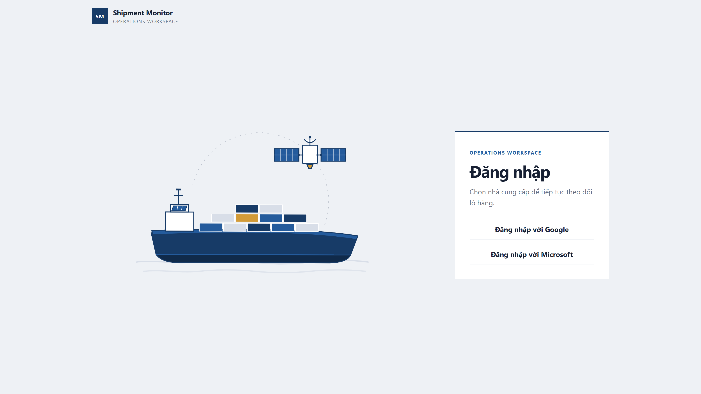

**Shipment creation.** The intake form captures the B/L number, container number, direction, Incoterm, carrier, and vessel. Direction is asked first because it changes which Incoterms apply: export and import each open a different set, and an unsupported pairing cannot be submitted. Submission starts the onboarding lookups that fetch the baseline arrival time.

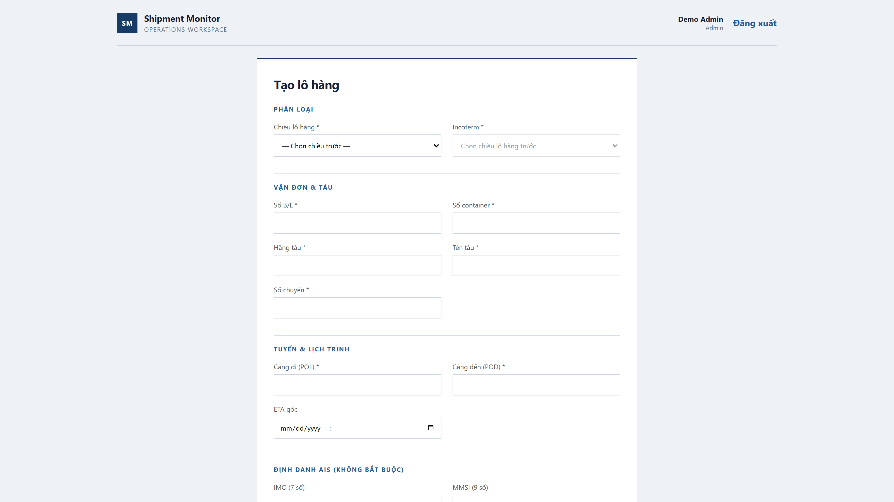

**Shipment list.** Every active shipment in one table, with a milestone bar showing how far each container has moved along its route. This replaces the four to five separate sources a representative opens today.

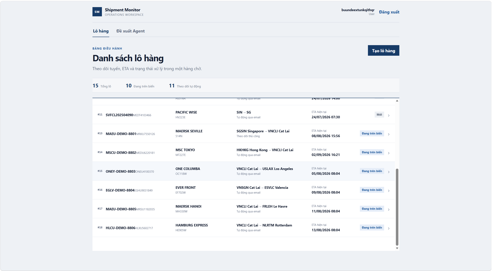

**Shipment detail.** One shipment, everything a representative needs before answering a call: the container and B/L identifiers, the vessel and voyage, the carrier, the port pair, the Incoterm, and the milestone strip with 24 of 30 milestones cleared. The map draws the completed trail, the remaining route, and the vessel's current position. The sea-conditions panel reads 14.2 kn of wind and 0.44 m of wave height; the ETA history panel records every revision with its reason and source.

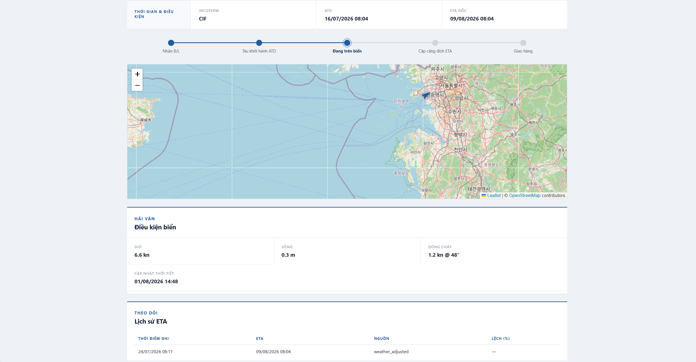

**ETA alert.** The same screen once the engine detects a variance past the threshold. This shipment sits 98.1 hours early against a baseline that expected 190.8 hours, a 48% deviation. The alert names the direction and the size of the change before the customer notices it, which is the whole point of the system.

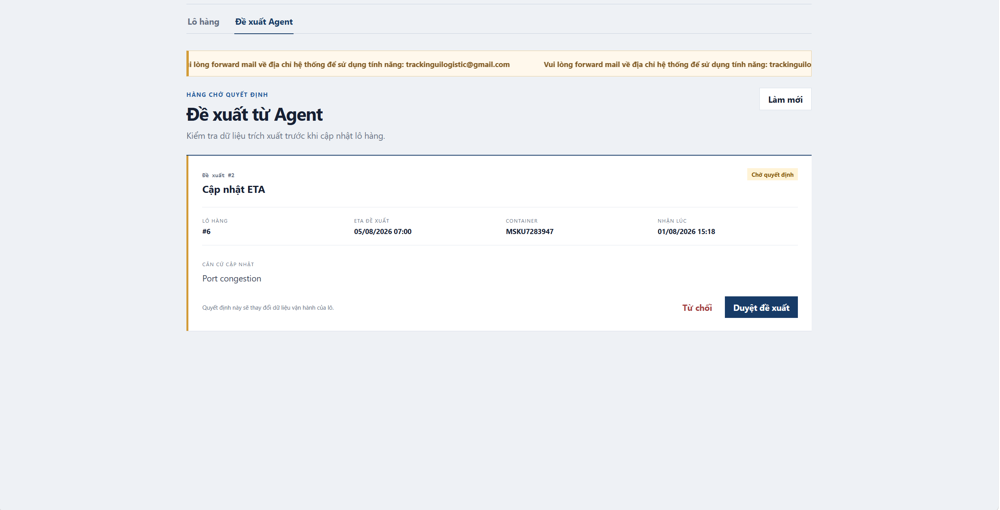

---

## The operating problem

Post-sales customer care at a freight forwarder runs on manual lookup. A sales representative receives an inquiry about one container, then opens four to five separate sources: the carrier website, the vessel tracking site, the port authority page, and an internal spreadsheet. Each lookup takes minutes, and the answer reaches the customer after the delay has already happened.

**Customer journey.** Five stages run from quotation to post-delivery. Customer care during transport and after handover is the part this system targets, and it sits across the last two stages rather than forming a stage of its own.

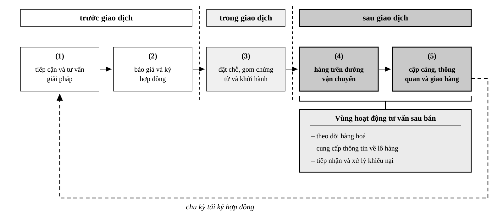

**Current process.** The flowchart records the manual steps for one inquiry, including the decision points where staff must interpret a carrier notice and decide whether a schedule change is real. Step 3 splits into two lookup branches: the carrier portal by B/L or container number, and public vessel tracking sites.

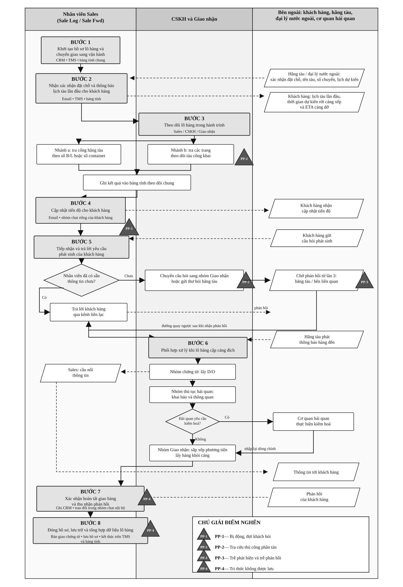

**Measured baseline.** The chart breaks lookup time into its parts. The largest share sits in switching between sources and re-entering the same container number, not in the lookup itself.

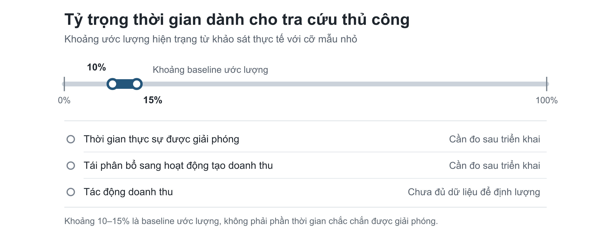

---

## Architecture

The system adds a monitoring layer beside the existing TMS and CRM. It reads shipment data and writes proposals; it does not replace transactional systems.

**Layer overview.** Five layers, numbered from the data at the bottom to the operator at the top: data and integrations, intelligence agents, orchestration and application services, presentation, and the operator workflow. The two bands on the right mark trust levels: lower layers are deterministic, the agent layer is probabilistic and only proposes, and the operator confirms.

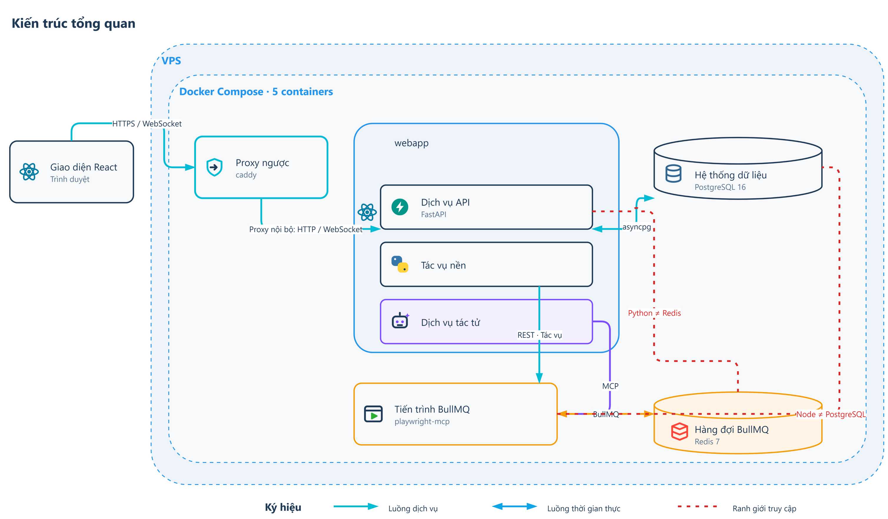

**Module boundaries.** The same system read as three modules. Module 1 tracks shipments, Module 2 handles inbound carrier email and raises proposals, Module 3 stores post-sales knowledge. External sources sit above, the business user sits below, and the existing business systems sit beside it as a parallel consumer of the same data.

**ETA engine.** The core calculation, in two tiers. Tier 1 runs a distance-over-speed estimate along the voyage path; Tier 2 applies an empirical adjustment for headwind, surface current, and the destination tidal window. Both tiers stay deterministic, and the result is written back as the baseline ETA with its confidence level.

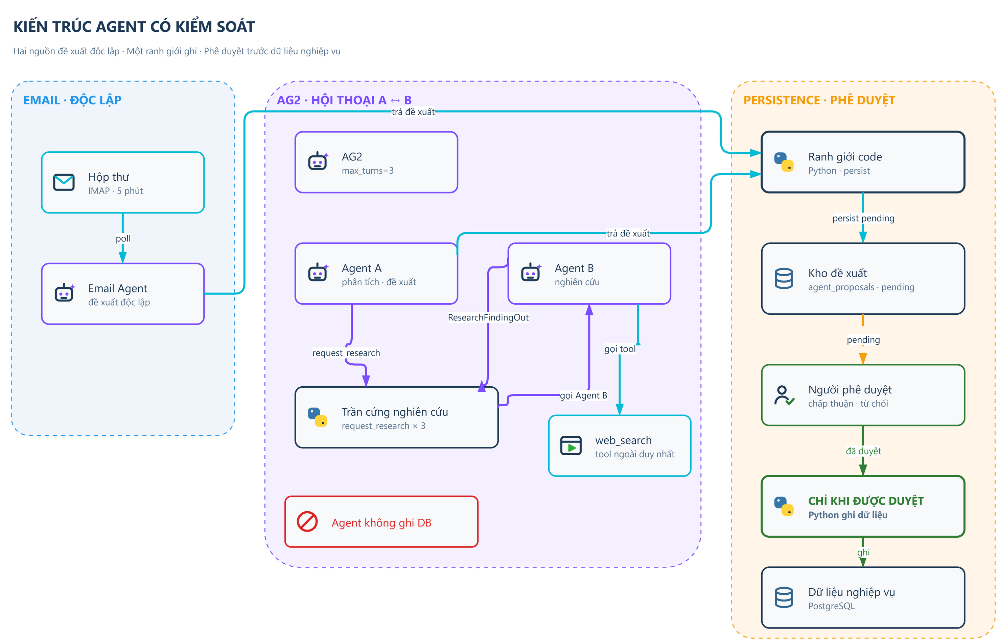

**Background workers.** Six workers run beside the API, each on its own cadence: onboarding fetches the baseline once, the AIS stream holds the live vessel position, the environmental poller refreshes weather and tide, the ETA engine recomputes arrival, the email agent reads carrier notices, and the reasoning agent writes the operational summary.

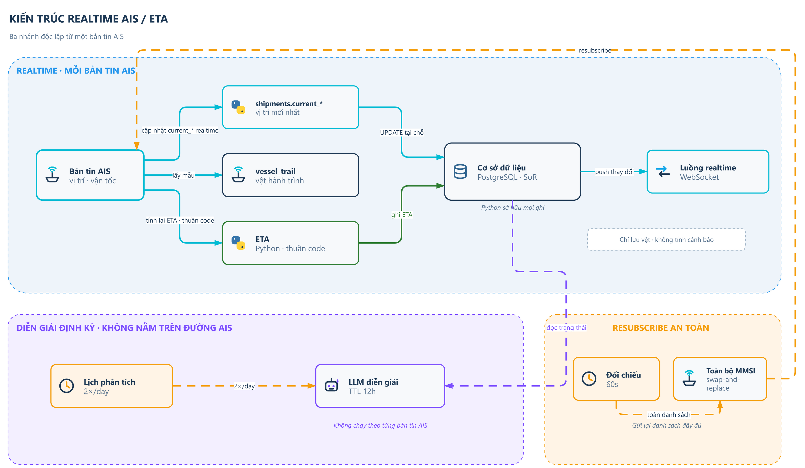

**Actors and tools.** The same five layers viewed by actor. Two human roles appear: the business user, whose workflow closes the loop, and the system operator, who configures rather than operates. Every external tool the system depends on sits in the lowest band: the carrier portal, the public vessel site, aisstream.io, Open-Meteo, the tide source, and IMAP.

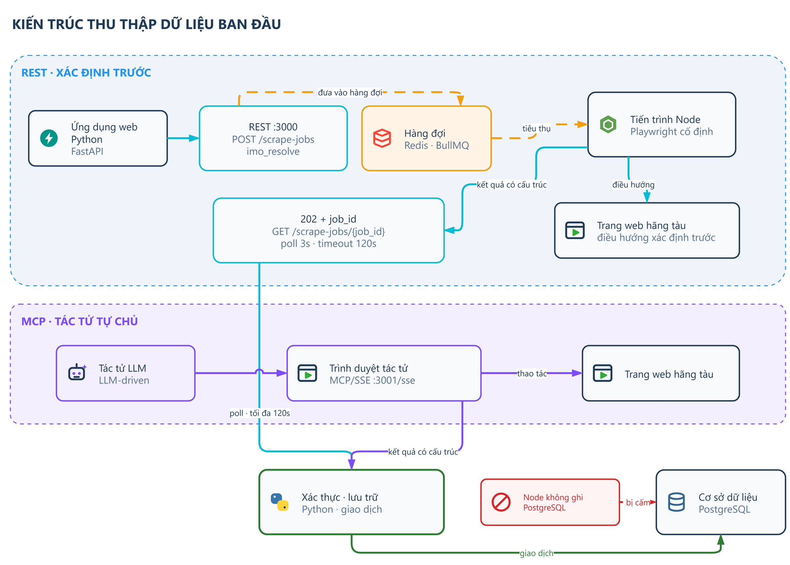

**Technology placement.** Every runtime component placed on the layer model, showing which service runs where and which boundary each one crosses.

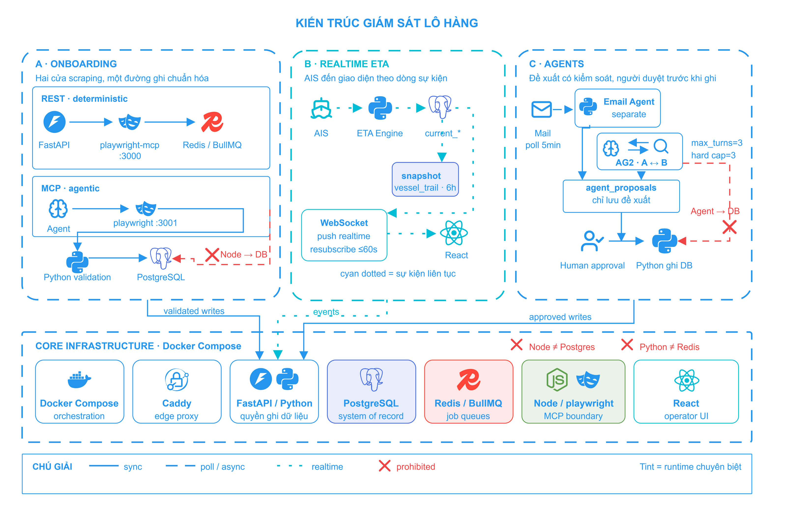

---

## Design

Before implementation, the solution was specified as screens and data contracts.

**Knowledge base wireframe.** The design for the screen that stores carrier quirks, vessel identifiers, and port handling notes. Frontline staff read from it during an inquiry, so the layout places search and filters above a result list, with a six-field detail panel beside it: situation, context, cause, chosen response, outcome, and the lesson recorded afterwards.

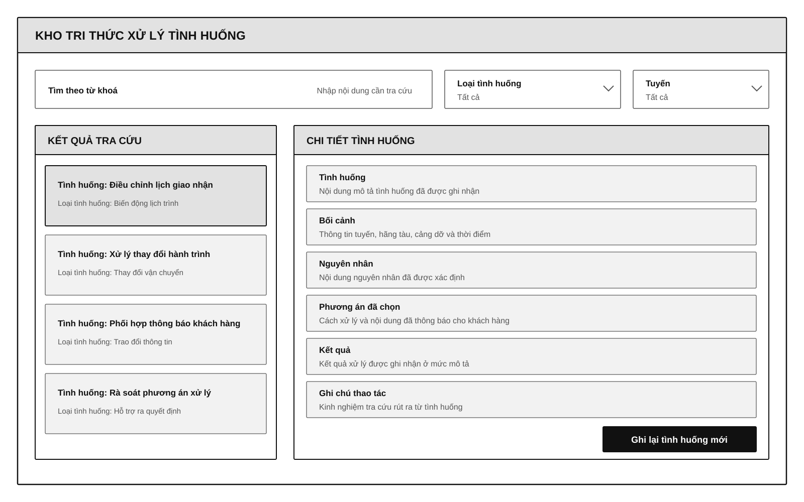

---

## Reading order

1. **The running application** — the five screens a frontline user touches per shipment.
2. **The operating problem** — why manual lookup fails at 20 to 30 concurrent shipments.
3. **Architecture** — how the monitoring layer sits beside existing systems.
4. **Design** — the knowledge base screen that captures staff expertise.

For written detail, continue with [Business Analysis](business-analysis.md) and [Architecture Overview](ARCHITECTURE.md).
